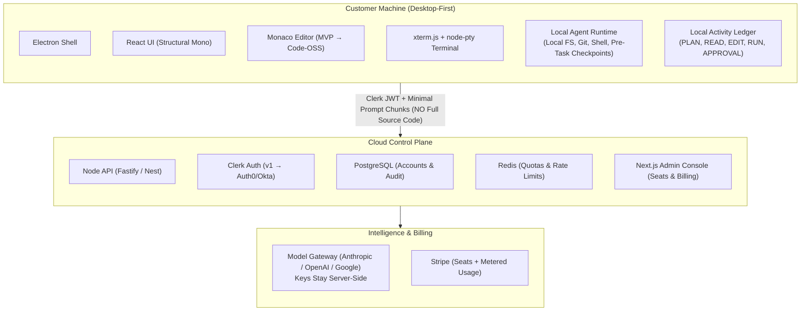

# Agentic IDE (Ledger) — Locked Technology Stack

> **Core Philosophy:** Desktop-first. All customer code stays 100% on the customer's machine. The cloud control plane strictly isolates identity, billing, quotas, and LLM proxying.

---

## 1. Language
* **TypeScript Everywhere** — Unified across Desktop client, Local Agent Runtime, Cloud Control Plane API, and Next.js Admin Console.

---

## 2. Desktop IDE (Customer Machine)
* **Shell:** **Electron** (native window, offline-first I/O, local OS integration)
* **UI Framework:** **React** (ported directly from the Ledger prototype design system)
* **Code Editor:** **Monaco Editor** (MVP) $\rightarrow$ **Code-OSS** (future roadmap)
* **Terminal:** **xterm.js** + **node-pty** (native pseudo-terminal sessions with allowlist sandboxing)
* **Local Agent Runtime:** Local Node-based agent runtime:
  * Direct local filesystem (`fs`) access
  * Local `git` commands and diff generation
  * Local shell tools executed via `node-pty`
  * Local auditable activity ledger (`PLAN`, `READ`, `EDIT`, `RUN`, `APPROVAL`)
  * Pre-task local snapshots with 1-click instant rollback

---

## 3. Cloud Control Plane
* **API:** **Node API** built on **Fastify** or **NestJS**
* **Databases:**
  * **PostgreSQL:** Accounts, seat licenses, workspace metadata, audit logs
  * **Redis:** Real-time quota enforcement, step limits, sliding-window rate limiting
* **Authentication:** **Clerk** (v1 turnkey auth), architected to be swappable to **Auth0** or **Okta** for enterprise SSO / SAML
* **Billing & Monetization:** **Stripe**
  * Flat seat subscriptions (Plus, Pro, Max)
  * Metered agent token / step overages
* **Intelligence Layer (Model Gateway):**
  * Multi-provider proxy: **Anthropic** (Claude), **OpenAI** (GPT-4o), **Google** (Gemini)
  * **Zero raw keys on client:** Provider API keys remain strictly server-side
  * Automatic failover routing (e.g., 503 fallback)
* **Admin Console:** **Next.js**
  * Team seat provisioning & invites
  * Quota management & usage metering charts
  * Billing portal & invoice history
  * SSO configuration

---

## 4. Product Shape & Security Boundary

### The Strict Code Boundary
* **What stays on the customer machine:**
  * 100% of source files, repository indexes, git trees, and confidential environment variables (`.env*`).
  * All code execution, compiler steps, and test runners.
  * Checkpoint backups and task rollbacks.
* **What passes to the cloud:**
  * User identity tokens via Clerk.
  * Aggregated quota telemetry (steps count, tokens used) for Stripe & Redis.
  * Only the prompt text and ranked semantic code chunks required for inference.

---

## 5. Design Language: Structural Mono
* **Palette:** High-contrast, near-monochrome surfaces (`#000000`, `#0a0a0b`, `#111113`, `#18181b`) with hairline borders (`#1f1f23`).
* **Signal Accent:** Blue (`#5b8def` / `#4c7fe6`) strictly reserved for active states, approvals, and actions.
* **Typography:** `Instrument Sans` / `Inter` for UI chrome paired with `IBM Plex Mono` for code, terminal, and ledger tags.
* **Paradigm:** Auditable state rows over free-form chat transcripts.

